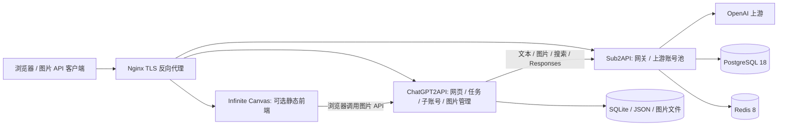

# GPTImage

基于 **Sub2API + ChatGPT2API** 的自托管图片生成与管理开发项目。它把两套应用的源码、集成补丁和 Docker Compose 部署入口放在同一仓库中，提供网页生图、图片编辑、图片归档、子账号业务额度和运行状态查看。

本项目是第三方集成方案，与 OpenAI 无隶属关系。需要自行配置可用的上游账号与访问权限；仓库不包含任何可直接使用的账号、令牌或运行数据。

## 架构



**统一上游链路**为 `ChatGPT2API → Sub2API → OpenAI`。默认开启 `SUB2API_ONLY=1`，文本、Responses、模型列表、搜索和图片请求使用 Sub2API；详情及不支持能力见 [统一路由说明](docs/SUB2API-ROUTING.md)。客户端也可以直接调用 Sub2API，此类调用不会进入 ChatGPT2API 的任务统计或图片管理。

## 已整合的能力

- 文生图和图片编辑通过 Sub2API 的标准 `/v1/images/generations`、`/v1/images/edits` 接口转发。
- 图片编辑保留蒙版、标注和点选评论处理。
- 透传 `gpt-image-2`、`gpt-image-2.5-flare`、`gpt-image-2.5-sunburst` 等已接入名称；实际是否可用由上游决定，不将名称透传视为模型身份保证。
- 新生成及编辑图片进入存储和图片管理；URL 格式返回可恢复地址，Base64 格式保持原有接口形式。
- 管理员新建子账号默认文本、图片业务额度无限制，仍记录已用和处理中数量；可分别改回有限额度。
- 严格模式下账号元信息和凭据刷新通过 Sub2API 管理接口，不调用 ChatGPT 网页初始化接口。
- 保留图片状态聚合接口；管理员生图页移除顶部状态面板，让主要空间用于对话和图片。
- 深色控制台 UI、琥珀强调色与响应式导航，保留浅色切换。
- 可选自托管无限画布，与 ChatGPT2API 共用生成、编辑和归档链路。
- 不伪造剩余生图张数：上游没有明确提供时显示未知，Codex 5 小时 / 7 天额度也不会换算成图片张数。

## 快速开始

要求：Docker Engine 或 Docker Desktop（Linux 容器）、Docker Compose v2、Python 3.10+。源码构建需要联网下载依赖；生产运行建议使用有足够内存和磁盘的 Linux 主机。小内存机器可以在其他机器构建镜像后部署。

```bash
git clone https://github.com/zhongguoyu/GPTImage.git
cd GPTImage
python scripts/setup.py init --public-url http://localhost:3000 --admin-email admin@example.com
docker compose up -d sub2api
```

1. 本机打开 `http://localhost:8080`，使用 `.env` 中生成的 `ADMIN_EMAIL` / `ADMIN_PASSWORD` 登录 Sub2API。远程机器通过 SSH 端口转发访问，或先配置反向代理。
2. 在 Sub2API 添加你有权使用的上游账号、分组，并创建一枚专供 ChatGPT2API 使用的 API 密钥，绑定所需分组。记下这枚密钥的**数字 ID**，不是分组 ID。
3. 写入这枚密钥（隐藏输入，不写进 shell 命令历史），再启动网页服务：

```bash
python scripts/setup.py upstream
docker compose up -d --build chatgpt2api
```

4. 打开 `http://localhost:3000`，使用 `.env` 中的 `CHATGPT2API_AUTH_KEY` 登录。
5. 在 ChatGPT2API 的 Sub2API 管理设置中添加内部地址 `http://sub2api:8080`，填写你自己的 Sub2API 管理凭证；需要账户同步和状态面板时完成此项，并按需导入账号。不要填写 localhost，因为这里的请求由容器发出。
6. 生成一张图，检查“图片管理”与任务状态。新建子账号时可取消“无限制”以设置具体业务额度。

初始化脚本不会覆盖已有 `.env` 和运行配置，也不会自动创建上游账号或 API 密钥。`.env`、`runtime/`、数据库、备份都已加入忽略规则。部署前请阅读 [部署指南](docs/DEPLOYMENT.md)。

## 目录

```text
GPTImage/
├── compose.yaml                 # 默认部署，Sub2API 镜像按 digest 固定
├── compose.canvas.yaml          # 可选：独立无限画布前端
├── compose.source.yaml          # 可选：从随附源码构建 Sub2API
├── upstream-lock.json           # 上游版本与来源
├── sources/chatgpt2api/          # MIT，上游 fork + 本项目集成补丁
├── sources/sub2api/              # LGPL-3.0，上游固定版本源码快照（OAuth 凭据脱敏）
├── config/                      # 无真实凭证的配置示例
├── deploy/                      # Nginx TLS 示例
├── scripts/                     # 初始化、发布检查
├── tests/                       # 集成仓库工具测试
└── docs/                        # 架构、配置、开发、运维、发布说明
```

## 文档

- [架构及数据流](docs/ARCHITECTURE.md)
- [部署与 HTTPS](docs/DEPLOYMENT.md)
- [配置与模型说明](docs/CONFIGURATION.md)
- [Sub2API 统一路由与限制](docs/SUB2API-ROUTING.md)
- [自托管无限画布](docs/INFINITE-CANVAS.md)
- [界面风格与布局](docs/UI.md)
- [验证记录与范围](docs/VALIDATION.md)
- [开发、回归测试和上游更新](docs/DEVELOPMENT.md)
- [备份、升级和故障排查](docs/OPERATIONS.md)
- [GitHub 发布检查](docs/PUBLISHING.md)
- [集成修改清单](docs/CHANGES.md)
- [来源与许可证](THIRD_PARTY_NOTICES.md)

## 数据与访问边界

“无限制”只表示本系统不设置子账号业务计数上限，不表示上游免费、无额度或无并发限制。图片管理当前是管理员功能；图片 URL 使用原项目的无登录读取路由，持有地址者可访问。不要把这种地址作为私密文件授权机制。生产使用请配置 TLS，并按实际需要设置保留天数、存储和访问控制。

本仓库是一份可继续开发的源码集成快照，未导入任何原服务器的 Git 历史、账号、图片、请求日志、数据库、域名证书或 SSH 私钥。详细验证范围见 [发布检查](docs/PUBLISHING.md)。

## 致谢与许可

- [basketikun/infinite-canvas](https://github.com/basketikun/infinite-canvas)（可选官方镜像）
- [Wei-Shaw/sub2api](https://github.com/Wei-Shaw/sub2api)
- [iamdurant/chatgpt2api-personal](https://github.com/iamdurant/chatgpt2api-personal)
- ChatGPT2API 原项目及两套项目的所有贡献者，完整说明见保留的上游 README 和许可证。

两套源码仍分别遵循原许可证。本仓库新增部署脚本和文档使用 MIT，不能用根目录许可证替代 Sub2API 的 LGPL 许可。详见 [THIRD_PARTY_NOTICES.md](THIRD_PARTY_NOTICES.md)。
